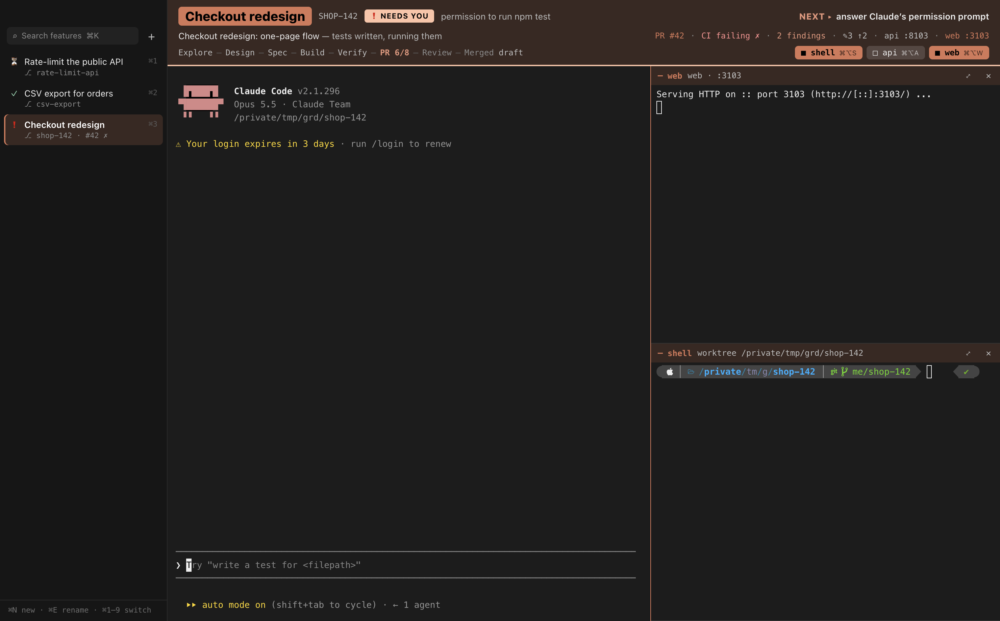
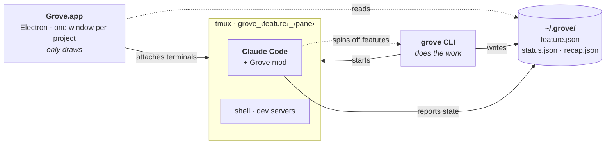

# Grove

A Mac app for running several Claude Code agents at once, one per feature. Each feature grows in its
own git worktree with its own branch, ports, dev servers and Claude session; Grove shows them side by
side and tells you which one needs you.



## Get started

Three steps. Details for each are further down.

**1. Install** (a Mac with Homebrew and Claude Code, signed in):

```sh
gh repo clone ramkivenkatachalam/grove ~/grove && ~/grove/install.sh --app
```

Then open **Grove** from Applications, and restart any Claude sessions you already have open so they
load Grove. ([What the installer does](#install))

**2. Add your project.** In the app: **Add project** (⌘⇧O) and pick the repo (its main checkout or any
of its worktrees). From a terminal: `grove project add ~/code/my-repo`. Grove guesses your dev servers,
ports and setup from the repo, or reads them from its [`.grove.json`](#projects). Without a
`.grove.json`, that guess comes from a few file checks: **Set up with Claude** on the review sheet (or
`grove project setup <name>`) has a Claude session read the repo and write a better one.

**3. Bring in what you're doing, or start something new:**

| You want to… | In the app | In a terminal |
|---|---|---|
| **Keep going on work already in progress** (worktrees, Claude conversations from the last 72 h) | Right after Add project, a review sheet lists them: tick what you want, **Bring in** (⌘↩). Later: ⌘⇧I | `grove import ~/code/my-repo` to see the list, then `--yes` to bring it all in |
| **Start a new feature** | **+ New** (⌘N): a name or ticket (`TICKET-123`), plus an optional task for Claude | `grove new csv-export -p "add CSV export to the report page"` |
| **Split work off a running session** | Ask Claude to *spin off a feature for …*; it writes the handover brief | `/feature new <name>` inside any Claude session |

Each feature gets its own worktree, branch, ports, dev servers and Claude session, and your existing
code and branches stay as they are. ([More on bringing in work](#bringing-in-work-that-already-exists))

**Day to day:** the sidebar shows which feature needs you (❗ needs you · ✓ your turn · ⏳ working);
⌘1–9 jumps to one. `grove up <name>` starts a feature's servers. When its PR merges, `grove done <name>`
(or `grove clean` for every merged one) removes it. If something looks wrong, run `grove doctor`.

## What you get

- **One window per project**, its name at the top of the sidebar; ⇄ opens another project and shows
  how many features need you elsewhere. Grove reopens the projects you had open.
- **Sidebar** (Warp-style): every feature with its state (❗ needs you · ✓ your turn · ⏳ working),
  title, branch and PR/CI. Search (⌘K), **+ New** (⌘N), double-click to rename, right-click for more.
- **Header**: the feature's title, state, a one-line recap, the **next step**, PR / CI / review
  findings, git status, ports and the lifecycle stage (Explore → … → Merged).
- **Main panel**: the feature's live Claude Code session.
- **Panels**: shell, backend and frontend logs, opened on the right (⌘⌥S / ⌘⌥B / ⌘⌥F) and zoomable (⌘⇧↩).
- **Spin-offs**: inside any session, ask Claude to *spin off a related feature*; it writes a handover
  brief, Grove creates the feature and switches to it.
- **Dock badge** with the number of features waiting on you, plus desktop notifications.

Quitting Grove stops nothing: every terminal is a tmux session (`grove_<feature>_<pane>`) that keeps running.
tmux keeps them in memory, though, so a reboot ends them and the features show *offline*. Opening a
feature in Grove brings it back: Claude continues its latest conversation and the dev servers restart on
the same ports. Features you haven't opened stay offline, and a turn Claude was in the middle of is not
redone. From a terminal, `grove fix <name>` (the Fix button, ⌘⇧F) does the same.

## Projects

Grove works with any git repo. A project config says how to grow a feature from it:

```sh
grove project add ~/code/my-repo     # reads my-repo/.grove.json, or writes a starter config
grove new csv-export                 # in or outside the repo; --project picks one explicitly
```

The config is the repo's own **`.grove.json`** (commit it to share it with your team) merged under
**`~/.grove/projects/<name>/project.json`** (yours; at least `{"repo": "~/code/my-repo"}`).

- `.grove.json` is read from the main checkout's **working tree**, not from `origin/main`: teammates
  get a change once they pull, and you can try an uncommitted edit locally before committing it.
- The merge is **shallow**: a key in your `project.json` replaces the team's whole value. To change one
  service, copy the whole `services` list. Only `setup` merges per sub-key, and even there your
  `setup.copy` (or `link`, `clone`, `run`) replaces the team's list rather than adding to it.
- A `.grove.json` that isn't valid JSON is ignored (you get your `project.json` and the defaults, so no
  services) with a warning on every command, and `grove doctor` reports it.

Without a `.grove.json`, the starter config is a guess from the repo: a `dev` script in a
`package.json` becomes a web service, a `main.py` or `manage.py` an API; Python envs (`.venv`, `venv`)
are linked into each worktree, `node_modules` cloned, untracked `.env*` files copied, and the base
branch follows `origin/HEAD`. Check it with `grove project show <name>`.

For a better config, let Claude write it: **Set up with Claude** on the review sheet after Add project,
or `grove project setup <name>` (`--draft` prints the brief, `--start` opens the session). A **Set up**
session under Sessions reads the repo and fills in your `project.json`: every dev server and its ports,
`env` rewrites so each feature's front end calls its own back end, setup, `checks` and `agentNotes`. It
writes only your `project.json` and checks it with `grove project show` and `grove doctor`. Then, each
only if you say yes, it tries the config on a throwaway `setup-check` feature (ports listening, servers
answering, logs clean) and closes it, and it proposes a `.grove.json` with the parts your team shares,
opened as a draft PR from its own feature, so teammates don't need to set the project up again. It is offered only when the repo has
no `.grove.json` (`--force` to ask anyway), and never starts on its own.

| Key | What it does |
|---|---|
| `services` | Dev servers, each `{name, dir, run, ports: [lo, hi], reserved, key, hint, open}`. Every feature gets its own port per service; each service is a panel |
| `setup` | Preparing a new worktree: `link` (symlink to the main checkout's copy, e.g. a venv), `clone` (copy-on-write clone, e.g. node_modules), `copy` (e.g. env files), `run` (shell commands) |
| `env` | Rewrites per worktree: `port` points `localhost:NNNN` in a key at a service; `set` sets a whole value (`{web}` = the web port) |
| `labels` | Shows a value from an env file as a label (e.g. which database) and warns on some (e.g. `PROD`) |
| `checks`, `agentNotes` | What Claude should run before finishing, and anything else it should know |
| `panels` | Extra panels beside the services, each `{name, run, dir, key}` (e.g. a test watcher) |
| `prs`, `ghUser` | `"prs": false` turns off PR/CI syncing; `ghUser` picks the `gh` account (otherwise Grove finds one that can see the repo and remembers it). Every pane Grove starts gets `GH_TOKEN` for that account, so Claude and your shells reach the repo without `gh auth switch` |
| `browser` | Where the app opens this project's links (service links, Open pull request, links in panes): `{"app": "Google Chrome", "profile": "Work"}`. `profile` is Chrome's profile folder (`Default`, `Profile 2`) or the name Chrome shows; `app` defaults to Google Chrome and can name another Chromium browser (Brave Browser, Microsoft Edge). Set it in your own `project.json` only. Unset, links open in your default browser |
| `base`, `branchPrefix`, `worktrees` | Branch start point, branch naming (`{user}/`), where worktrees go (default: each feature's folder in `~/.grove`) |

See [`examples/nextjs-fastapi.grove.json`](examples/nextjs-fastapi.grove.json).

## Bringing in work that already exists

In the app: **Add project** (⌘⇧O) and choose the repo — its main checkout or any of its worktrees.
Grove registers it and shows what is already in flight on it:

- **Worktrees** of the repo that Grove isn't running, newest first, each with what makes it worth
  bringing in: uncommitted changes, commits ahead of the base branch, its latest Claude conversation.
  Ones with nothing new for three weeks start unticked.
- **Claude conversations** from the main checkout in the last 72 hours (e.g. an iTerm tab).
- **How Grove will run them**: the services, ports and setup it guessed (or read from `.grove.json`),
  with a link to fix `project.json` first.

Tick what you want and **Bring in** (⌘↩). Each worktree becomes a feature with its own ports and Claude
session, named after its PR or its Claude conversation; your code and branch stay as they are. Each
conversation moves under **Sessions** and resumes with its full history once you `/exit` the old copy.

If something can't come in (a port range that's full, a setup step that fails), the rest still does,
so you can get going. The sidebar then says "1 couldn't come in · **Fix with Claude**". That shows each
error and the brief Grove wrote for Claude: what failed, the exact error, the command to retry, where
the config lives, and what not to touch. Edit it if you like; **Start fixing** opens a **Fix import**
session under Sessions that works through it, with Claude Code's usual permission prompts. Each item
drops off the list once it is in Grove. (`grove fix-import --draft` prints the same brief.)

Later, when a worktree or conversation shows up outside Grove (made in a terminal out of habit), the
sidebar says so ("2 in progress outside Grove · Review"); **Project › Bring In Existing Work…** (⌘⇧I)
opens the same review. What you leave unticked stops being mentioned.

From a terminal, the same thing:

```sh
grove import ~/code/my-repo          # registers it if new; lists what is not in Grove yet (--json for tools)
grove import --project my-repo --yes # brings in all of it
```

Or one at a time:

| You have | Command | What happens |
|---|---|---|
| A worktree you made earlier | `grove adopt <worktree>…` | It becomes a feature: its own ports and env, a title from its PR, a ticket from its branch; services start stopped (`grove up <name>`) |
| A Claude conversation in a main checkout (e.g. an iTerm tab) | `grove sessions`, then `grove adopt --session <id>…` | It appears under **Sessions**; its panel waits for you to `/exit` the old copy, then resumes it with its full history |

Grove can't take over a running process, so a conversation moves by resuming it, and Grove refuses
to start a second Claude on a worktree that already has one.

## Commands

| Command | Does |
|---|---|
| `grove ls` | Features, ports, labels, PR/CI, state, recap → next |
| `grove go <name>` · `grove attach` | Open a feature and switch to it · attach this terminal to Grove's tmux session (the terminal-only front end) |
| `grove new <name\|TICKET> [-p task]` | A new feature: worktree, ports, env, services, a briefed Claude |
| `grove import [<repo>] [--yes]` | Register a repo and bring in its worktrees and recent conversations (above) |
| `grove adopt …` · `grove sessions` | Bring in existing worktrees or conversations one at a time (above) |
| `grove up\|down\|restart <name>` | Start, stop or restart a feature's services |
| `grove fix <name>` | Repair only what is broken: reopen missing panels, start Claude if its pane is back at a prompt, restart services whose port is not listening. Safe any time; the app's Fix button (⌘⇧F) runs it |
| `grove rename <name> <title>` | The title shown in Grove |
| `grove done <name> [--keep\|--force]` · `grove clean [--yes]` | Close a feature: removes its worktree, branch and state (notes and retro go to the project's `archive/`); stops if it has uncommitted or unmerged work unless `--force`, `--keep` keeps worktree and branch · close every merged, clean one |
| `grove doctor` | Check projects and features: files, deps, ports, env, labels |
| `grove project add\|ls\|default\|show\|setup` | Manage projects; `setup` has Claude write a project's config |
| `grove pr` · `grove findings <name>` | Refresh PR/CI · list unanswered review-bot findings |
| `grove retro <name>` | Drafts the feature's retro (what went well, what didn't, what to try next time with an agent) into its `retro.md`, from its conversations, recap and git. The Summary tab's Retro section has the same button |
| `grove send <name> <text…>` | Types text into a feature's Claude session as one message (starts the session if needed). The Summary tab's Scratchpad sends a selection this way |
| `grove shot <name> [--clip \| --window \| <image>] [note…]` | A screenshot for the agent: drag a region (`--window`: click a window, `--clip`: the clipboard's image, or an image file). It is kept in the feature's `shots/` folder and its path pasted at Claude's prompt, which attaches it; a note sends it at once. In the app: ⌘⇧S, ⌘V of a copied image, or drop files on a terminal |
| `grove recap <name> [--force]` | A scannable recap of a feature (goal, done, now, next, decisions, blockers) for its Summary tab. Sessions refresh it after each turn, at most every 3 minutes, and skip when nothing changed |
| `grove statusline` | Claude Code's status line (install.sh sets it). In the app: model · context used/limit · cost · session time · lines changed, and it keeps the feature's `stats.json` for the Usage tab (⌃3: context meter by cache use, session totals, plan limits, and a button that runs `/context`) |
| `grove keepawake [on\|off\|--status]` | Keeps the Mac awake while any agent is working (sessions start it; it lets go when all are idle). `off` turns it off |
| `grove theme [palette]` · `grove ui app\|tmux` | Header palette · which front end new features open in |

## Install

You need a Mac with Homebrew and Claude Code (signed in). Then, in a terminal:

```sh
gh repo clone ramkivenkatachalam/grove ~/grove && ~/grove/install.sh --app ~/code/my-repo
```

(`git clone` works too, if you have the repo URL.) Grove is built on your Mac rather than downloaded,
so macOS opens it without a security prompt. Then open **Grove** from Applications.

`install.sh`:

1. checks for `git`, `tmux`, `gh`, `claude` and `python3` (and `node` with `--app`), and offers to
   `brew install` the missing ones (`--yes` installs without asking)
2. links `cli/`, `mod/` and `tmux/` into `~/.grove`, puts `grove` on your PATH (`~/.local/bin`) and adds
   `source-file ~/.grove/tmux.conf` to your `~/.tmux.conf`
3. has every Claude Code session load the mod: it adds `env.CLAUDE_CODE_PLUGIN_DIRS` (and a status
   line, if you have none) to `~/.claude/settings.json`, keeping a backup
4. with `--app`, builds Grove.app into `/Applications` (quitting and reopening Grove if it is running;
   agents and servers keep running)

With `--app` it also gives your Mac a local code-signing identity, a self-signed certificate named
"Grove Local Signing" in your login keychain (`scripts/signing-identity.sh`; macOS asks for your password
once to trust it for code signing). Every build is signed with it, so permissions you give Grove, such as
Screen Recording for screenshots, last across rebuilds and `grove update`. Without it the app is signed
ad-hoc and macOS forgets those permissions on every rebuild. The first build signed with the identity is
new to macOS, so grant Screen Recording once more (remove the old Grove entry in System Settings →
Privacy & Security → Screen & System Audio Recording, add the new one, reopen Grove); after that it sticks.
5. for each repo you name, runs `grove import` as a dry run ([above](#bringing-in-work-that-already-exists))

To update: `grove update` (or **Grove → Update Grove…** in the app). It fast-forwards the checkout (never over
local changes or local commits), which updates the CLI and the mod at once, and rebuilds the app only when
its own files changed, reopening it if it was running. The app checks every 6 hours and offers an update with
a notification; `grove update --auto on` lets it install them itself while Grove is in the background.
`grove update --check` only looks. `git pull && ./install.sh --app` still works. **Grove → About Grove** shows
the build that is running (commit, PR, build time, and "dirty" if built from uncommitted changes), plus the
branch, hub and CLI only when they differ from a normal install.

It is safe to re-run. Then restart running Claude sessions so they load the mod, and run `grove doctor`.

## How it fits together



The app only draws; the CLI does the work; the mod reports from inside each Claude session; tmux
hosts every process, so the app can come and go.


| Piece | Where | Role |
|---|---|---|
| App | `main.js`, `preload.js`, `ptybridge.py`, `renderer/` | Electron + React + xterm.js. Reads state from `~/.grove`, attaches terminals to tmux sessions through a tiny Python pty bridge (no native modules) |
| `grove` CLI | `cli/grove` | Python, stdlib only. Projects, worktrees, per-service port allocation, env rewriting, dev servers, PR/CI sync, review-bot findings, ticket briefs, cleanup, `grove doctor` |
| Claude Code mod | `mod/` | Function hooks loaded by every Claude Code session: publishes each session's state, recap and next step, notifications, the `new_feature` tool, `/feature` commands |
| tmux | `grove_<feature>_<pane>` sessions | Hosts every Claude, service and shell process; the app attaches to them and nothing stops when it quits |
| tmux config | `tmux/grove.tmux.conf` | The terminal-only front end (header in tmux's status line), used with `grove ui tmux` |

State lives in `~/.grove/`, one folder per project and per feature:

```
~/.grove/projects/<project>/project.json             your config for the project
~/.grove/projects/<project>/<feature>/feature.json   registry entry
                                     /status.json    session state, written by the mod
                                     /brief.md       the task; brief.sent.md once Claude has it
                                     /recap.json     the Summary tab's recap (grove recap)
                                     /notes.md  retro.md   the Summary tab's Scratchpad and Retro
                                     /stats.json     the Usage tab: model, context, cost (grove statusline)
                                     /worktree/      the feature's git worktree
~/.grove/projects/<project>/s-<id>/                  a conversation under Sessions: feature.json
                                                     (kind "session"), status.json, recap.json; no worktree
~/.grove/projects/<project>/archive/<feature>/       notes and retro kept by grove done
~/.grove/projects/<project>/prs.json                 your PRs on the repo, by branch (grove pr); "error" while GitHub is unreachable
                           /findings.json            review-bot comments already seen, by PR number
                           /github.json              the gh account that can see the repo
~/.grove/config.json       ui (app|tmux), defaultProject, keepAwake
~/.grove/focus.json        the feature the app should switch to (written by grove new, import)
~/.grove/theme.json        header palettes (grove theme)
~/.grove/bin/grove  mod  tmux.conf                   links into the repo, made by install.sh
```

PR state is kept per project because branch names are only unique within one repo. A hub from an
older version moves over with `grove migrate` (existing worktrees stay put; their feature folders link to them).

## Develop

| Task | Command |
|---|---|
| Run from source | `npm start` |
| Rebuild and reinstall the app | `npm run install-app` (quit Grove first) |
| Create the local signing identity (once; builds fall back to ad-hoc without it) | `scripts/signing-identity.sh` |
| Regenerate the icon from `build/icon.svg` | `npm run icon` |
| Screenshot the app (visual checks) | `GROVE_SCREENSHOT=/tmp/grove.png npx electron .` |
| Validate / test the mod | `claude plugin validate mod && claude plugin test mod` |
| Test onboarding end to end (fake home, sample repo; touches nothing real) | `scripts/try-onboarding.sh check` |
| Click through onboarding in the app, as a new user | `scripts/try-onboarding.sh app` (`--added`: the review sheet; `--imported`; `--demo`: with Claude conversations), then `… clean` |

## Keys

⌘/ shows them all (Help › Keyboard Shortcuts, or the sidebar footer) · ⌘1–9 switch feature · ⌘⇧1–9 open project · ⌘⇧O add project · ⌘⇧I bring in existing work · ⌘N new · ⌘E rename · ⌘K find · ⌘⌥S/B/F shell/be/fe · ⌘⇧↩ zoom panel ·
⌘⇧R restart servers · ⌘⇧S screenshot to the agent (⌘⌥⇧S a window; ⌘V pastes a copied image; drop files on a terminal) · right-click a feature for more · ⌥-drag selects text inside a terminal.

## License

[MIT](LICENSE): use, copy, change and sell it; keep the copyright notice. No warranty.
